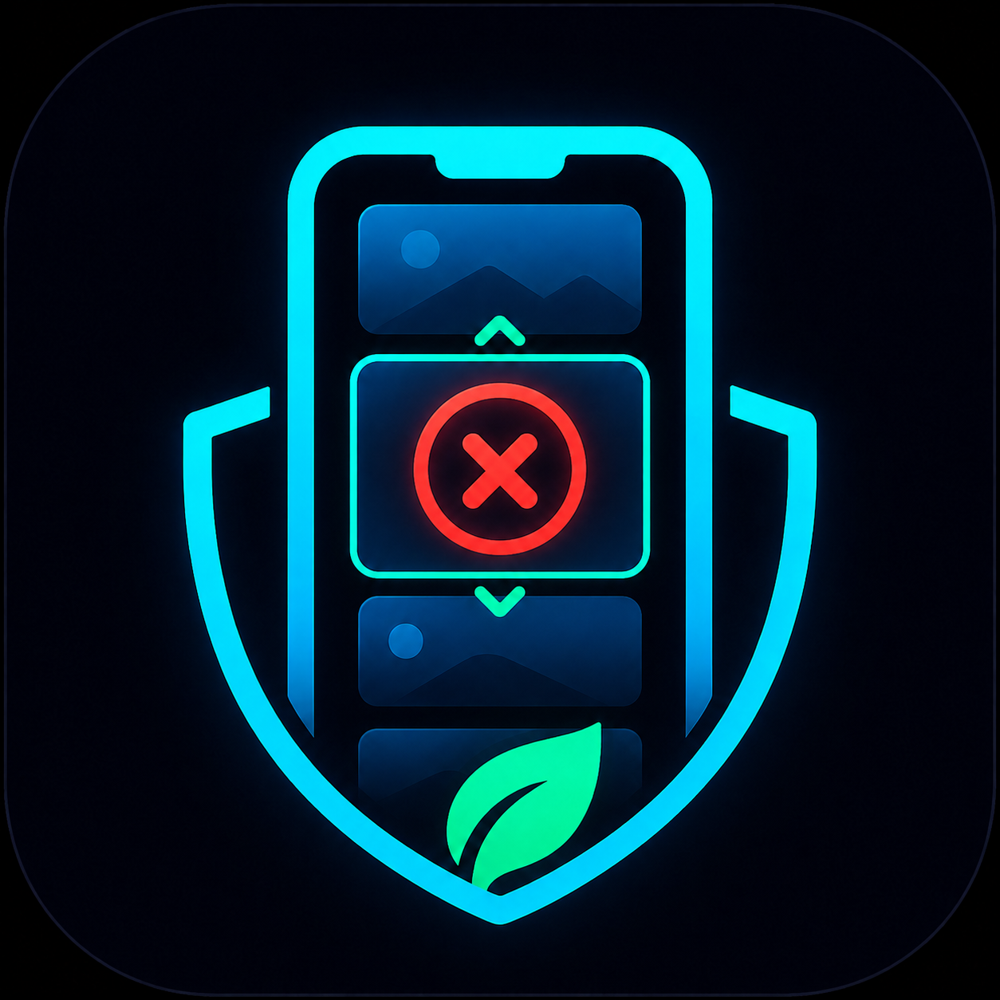
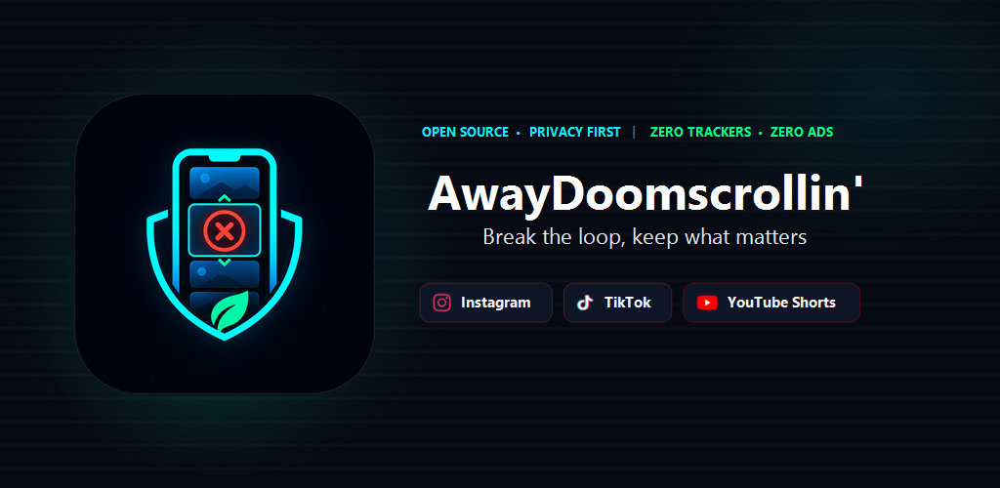

<p align="center">
  
</p>

<h1 align="center">AwayDoomscrollin'</h1>

<p align="center">
  An open-source Android app that covers short-video feeds in Instagram and YouTube
  and interrupts feed scrolling in TikTok.<br/>
  <a href="https://awaydoomscrollin.com">awaydoomscrollin.com</a>
</p>

<p align="center">
  <a href="https://github.com/resolvecommunity/AwayDoomscrollin/releases/latest"></a>
  <a href="https://f-droid.org/packages/com.resolvecommunity.awaydoomscrollin/"></a>
  <a href="https://www.gnu.org/licenses/gpl-3.0"></a>
  <a href="https://www.bestpractices.dev/projects/14458"></a>
</p>

<p align="center">
  
</p>

## About

AwayDoomscrollin' is a digital wellbeing app for people who want to keep using
Instagram, YouTube and TikTok for messages, search and things they chose to
watch, without getting pulled into endless short-video feeds. It does not set
time limits. Instead it covers the feeds themselves and stops the move from one
short video to the next.

The app is in public beta. It relies on accessibility information exposed by
other apps, so updates to those apps, Android or the phone's software can delay
detection or cause missed or incorrect detections.

## What it covers

Instagram and YouTube have two modes. TikTok has a single protection setting.

| App | Both modes | Balanced | Strict |
|---|---|---|---|
| Instagram | Home and Explore are covered and the Reels tab is blocked. Messages and account search stay open; the suggested grid under keyword search results is covered. | Profiles, profile posts, Stories, Highlights and your Saved, Liked and Reposted lists stay open. One Reel you open can be watched with its comments; moving to the next video closes it. | Profile posts are covered. Reels, including those shared in messages, Stories and Highlights are blocked. Saved, Liked and Reposted lists are closed. |
| YouTube | Home and Subscriptions are covered and the Shorts tab is blocked. Search results, channels, playlists, the You tab and long videos stay open. | One Short opened from search, a channel or a link can be watched with its comments; moving to the next video closes it. | All Shorts are blocked, wherever they are opened. |

TikTok: browsing, messages, profiles, search and comments stay open. The first
vertical swipe in the For You or Friends feed takes you back, and switching to
the Following or Community tabs is undone.

The app also keeps local statistics: blocks per app, the busiest hour of the
day, measured Instagram and YouTube curtain time, a daily streak and
achievements. These stay on the device.

## Installation

Requires Android 8.0 or newer.

- **F-Droid:** [f-droid.org/packages/com.resolvecommunity.awaydoomscrollin](https://f-droid.org/packages/com.resolvecommunity.awaydoomscrollin/)
- **Google Play:** [play.google.com/store/apps/details?id=com.resolvecommunity.awaydoomscrollin](https://play.google.com/store/apps/details?id=com.resolvecommunity.awaydoomscrollin)
- **GitHub:** signed APKs on the [releases page](https://github.com/resolvecommunity/AwayDoomscrollin/releases/latest)

GitHub and F-Droid builds are signed with the same key. Its SHA-256 certificate
fingerprint is:

```
c59c79a593d1e026f92f5ab264626dfc0799046df6b7ee83b254863db8ab8716
```

You can compare it with the output of `apksigner verify --print-certs` for a
downloaded APK. The Google Play build uses Play App Signing and may not match
this fingerprint; switching between the Play build and a GitHub or F-Droid build
can require uninstalling first.

### Turning on accessibility for an APK installed outside a store

Android 13 and newer restrict accessibility access for apps installed from an
APK file. If the AwayDoomscrollin' switch is greyed out in Accessibility
settings:

1. Open **Settings > Apps > AwayDoomscrollin'**.
2. Tap the three-dot menu in the top-right corner and choose **Allow restricted settings**.
3. Confirm with your PIN or fingerprint, then turn the service on in Accessibility settings.

Menu names differ between phone makers. Step-by-step guides are available in
[English](https://awaydoomscrollin.com/en/guide) and
[Turkish](https://awaydoomscrollin.com/tr/rehber).

## Privacy

- Screen information is read through Android's Accessibility Service and
  processed in memory on the device. The app does not take screenshots, record
  the screen or log keystrokes, and it does not store or send what it reads
  from the screen.
- Before Android's accessibility settings open, the app explains what the
  permission is used for. Declining leaves protection off.
- The `INTERNET` permission is used only for optional usage data, which is off
  by default and needs a separate opt-in. When enabled, it sends a random
  installation ID, device model and screen size, Android and app versions,
  block counts and measured curtain time; automatic reports are sent at most
  once every 24 hours. It never includes messages or screen content.
- The app contains no advertising, analytics or tracking libraries.

The full [privacy policy](https://awaydoomscrollin.com/privacy) describes what
is collected and how long it is kept.

## Building from source

Requirements: Android SDK 36, JDK 17.

```bash
git clone https://github.com/resolvecommunity/AwayDoomscrollin.git
cd AwayDoomscrollin
./gradlew assembleDebug
```

On Windows, use `gradlew.bat assembleDebug`. The debug APK is written to
`app/build/outputs/apk/debug/app-debug.apk` and uses a separate `.debug`
application ID, so it can be installed next to a release build. Unit tests run
with `./gradlew testDebugUnitTest`.

Release builds need a signing key. A release APK built without one is unsigned
and only useful as a build check.

Changes in the current version are listed in the
[v1.3.0 release notes](RELEASE_NOTES.md).

## Contributing and security

Bug reports and pull requests are welcome; see [CONTRIBUTING.md](CONTRIBUTING.md).
Please report security issues privately as described in [SECURITY.md](SECURITY.md).

## License

Copyright (C) 2026 Resolve Community

This program is free software: you can redistribute it and/or modify it under
the terms of the GNU General Public License as published by the Free Software
Foundation, version 3 of the License (GPL-3.0-only). See [LICENSE](LICENSE) for
the full text.
